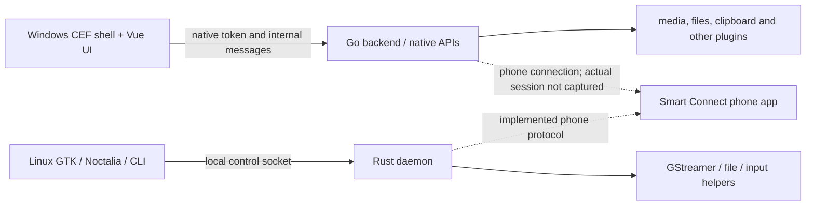

# Windows Smart Connect 9.0.4.003.000: artifact review and Linux comparison

Reviewed 2026-11-16 UTC (2026-11-15 US Eastern), using REA CLI 6.8.0.
Linux baseline: [`8f2b1905a1df4c2a8d9d6240494a29127aa45a87`](https://github.com/NightBreedLabs/smartconnect-linux/tree/8f2b1905a1df4c2a8d9d6240494a29127aa45a87).
The local checkout and GitHub `master` agreed at the start of this review.

The Windows installation provides useful evidence for improving the Linux peer. It combines a
native CEF shell, Vue frontend, Go networking libraries and native feature plugins. The Linux
implementation covers much of the same territory through Rust, GStreamer and desktop integrations.
Internal Windows UI commands are a separate boundary from the phone wire protocol.

This is a bounded artifact review, not a claim that every Windows feature was reconstructed or
tested. **OBSERVED** means read from an identified artifact, source or recorded log.
**INFERRED** means an interpretation supported by those observations. **UNKNOWN** means the
necessary code-flow or runtime evidence has not been established.

## Inputs and method

- **OBSERVED:** the x64 installer came from
  [Lenovo](https://download.lenovo.com/lenovo/readyfor/SmartConnect_setup_09.0.4.003.000.exe).
  Its SHA-256 matched the
  [Microsoft Store manifest](https://storeedgefd.dsx.mp.microsoft.com/v9.0/packageManifests/XP8JRF5SXV03ZM):
  `98673ac3d446614e47fbf4dee2f540af8cf4b9c746923e08547cbe4f1b0562ee`.
- The owner installed it with WineZGUI. Analysis read that installation and two existing startup
  logs. It did not launch or modify the Windows app, change Wine, or connect the app to a phone.
- A local inventory hashes 488 installed files, totaling 546,931,688 bytes. Vendor binaries,
  frontend source, decompilation and raw logs are excluded from this repository.
- REA inspected ten selected first-party PE import tables, three executable resource/certificate
  tables, and Go build metadata. Supplemental read-only parsing recovered Go function-name tables.
  Names and imports establish declarations, not successful execution.
- REA's broad frontend pass exceeded a 90-second source deadline on the entry bundle. The failure
  retains partial evidence; it is not a successful full scan. A narrower pass parsed three feature
  bundles. A separate pass parsed 18 AST-selected entry-bundle declarations, with original hashes
  and byte-range mappings. Dependencies outside those slices remain unresolved. `coreapp.html`
  and plugin configuration were also read as inert text.

Selected artifact identities, relative to the installed application directory:

| Artifact | SHA-256 |
|---|---|
| `SmartConnect.exe` | `6679574d8cdd223c347b075e637e8eabeec447ad9bfd3a605e5e7683fb0d296c` |
| `winapi.dll` | `5c5ebb400b3d5361a9bd16d489325849942305a33aac3e0b6609a7dd6c3799e8` |
| `RfaRpc.dll` | `410f3540a54a01f3b4f4ba26bffbe7ff3a60da7a6c9bb5a4e934713ddc5cb8e7` |
| `plugins.json` | `2f5ded3ca4ec36ca691a88488080c464dd975af39c56005e87a25de61e816be1` |
| `html/assets/index-_xhYfTGI.js` | `dec4923a177b46ae810a8d084afb918af1ad2262398f3e39b42514c21450086b` |

## Architecture and Windows dependencies

**OBSERVED:** `SmartConnect.exe` imports Chromium Embedded Framework, Media Foundation, D3D11,
DXGI, DirectComposition, WLAN, Bluetooth, COM and UIAutomation. It delay-loads `winapi.dll`.
The shipped HTML loads a Vue-based dashboard; it is not an Electron package.

REA's embedded Go metadata identifies `winapi.dll` and `RfaRpc.dll` as Go 1.25.0 c-shared builds
for windows/amd64. Module paths end in `libs/winapi` and `libs/RfaRpc`. Both record source revision
`9b4d341c41f5881825104daf4fac700aea77a977` with modified/dirty source state. These are build
declarations, not independent authentication of the compiler or source tree.

`winapi.dll` declares WebSocket, mDNS/zeroconf, Pion WebRTC/ICE/DTLS/SRTP, MCP, clipboard and
filesystem-watcher dependencies. `RfaRpc.dll` declares smux. This supports a native shell with a
Go networking/backend layer and inter-component RPC; dependency presence alone does not establish
which path executes for a particular feature.

`AppStream.dll` imports SDL3, superlink20, DragDrop, D3D11/DXGI/DirectComposition and HID/SetupAPI.
`NativeAPI.dll` exposes BLE, Wi-Fi Direct, hotspot, notification, lock-screen and A2DP-related names.
`ReadyForService.exe` imports Windows service-control and session/token/process APIs; its manifest
requests `requireAdministrator`, while the UI executables request `asInvoker`.

**INFERRED:** displaying a window under Wine would establish only the first layer of compatibility.
It would not demonstrate working media, input, services, camera or wireless integration. Linux
equivalents belong in the existing helpers and desktop integrations.

## Plugin declarations and Linux counterparts

These are **OBSERVED** `plugins.json` capability declarations, not a captured `serviceVersions`
handshake. A missing entry does not establish absence of a feature elsewhere in Windows.

| Windows component | Declared service IDs and levels | Linux counterpart at the baseline |
|---|---|---|
| ScreenShare | `202:1` | `display/`, phone as display |
| Vault | `201:3`, `168:3` | `files/`, File Station and shared folders |
| AppStream | `15:3`, `16:3`, `21:3` | `mirror/`; general service-21 audio remains separate work |
| ClipBoard | `9:3` | `src/clipboard.rs` |
| DragDrop | `24:3` | No complete equivalent established by this review |
| Webcam | `3:3` | `webcam/` |
| SmartAI | `31:3`, `311:3`, `313:3` | No corresponding AI plugin in the current workspace |
| iOS | `204:1` | `src/sms.rs` also handles service 204 for Android messaging; the plugin name does not make the ID exclusively iOS |

The manifest also declares native/executable boot modes and startup triggers, not the negotiated
phone payload schemas. Do not replace Linux's service-15 **version 16** with the plugin's
capability **level 3**: those are different fields. See [src/proto.rs](../../src/proto.rs#L12).

## Internal UI messages versus phone messages

**OBSERVED, static:** selected entry-bundle declarations name manager 0, file exchange 2,
webcam 3, clipboard 9, applications 15, input 16, app list 17, pairing 19, device status 25,
Cross Control 26, PC UI 99, PC webview 100, file access 168, File Station 201, PC screen
sharing 202, iOS/messaging 204, and gallery 205. A declared ID is not proof of advertisement
or successful use with a particular phone.

The selected reconnect function asks `window.cefQuery` for a token, then opens a WebSocket.
The URL builder derives the endpoint from the page origin/host. The on-open handler sends a
message with `remoteDeviceId` set to `localhost`, service ID, token and page source. A send helper
adds webview transport metadata to ordinary UI messages. This is not the phone's pairing handshake.

The extracted message UI has device-keyed state and local plugin commands for contacts, history,
SMS, read state, permissions, MMS details and send availability. Its `PLUGIN_SEND_SMS` value is 2;
Linux's phone-side `cmd::SEND` is 4, inside a `pId:110` / `ver:"5.0"` wrapper in
[src/sms.rs](../../src/sms.rs#L17). **That is not evidence of a protocol regression:** the
translation from internal plugin API to phone message must be traced first.

Similarly, an audio-file pagination constant concerns file browsing, not a service-21 audio
command. These frontend observations can guide Linux UI design, but cannot fill missing native
protocol command numbers by themselves.

## Comparison and follow-up priorities

| Area | Source-observed Linux state | What the Windows artifacts add | Remaining verification |
|---|---|---|---|
| Version negotiation | [invite.rs](../../src/invite.rs#L20) reports `09.0.3.013.000` / `903013000`; [proto.rs](../../src/proto.rs#L12) derives service versions from that build | The installed build is newer, `09.0.4.003.000` | Capture or reconstruct its real handshake; do not blindly bump constants or substitute plugin caps |
| Reconnect authentication | [server.rs](../../src/server.rs#L436) accepts a valid invite token **or** a known stable device ID; TLS has no client certificates at line 328 | Named Go handlers for reconnect, paired keys, shared keys and certificate callbacks | Establish server-side possession checks and compare equivalent connection directions |
| General file transfer | [fex CLI](../../fex/src/main.rs#L30) exposes icon fetch and pull; the phone mount is read-only; creation/upload remains incomplete | Dedicated sender, receiver, direct-send and connection-verification names, plus Vault and DragDrop plugins | Recover transfer lifecycle and write/create behavior before implementing general upload |
| Multiple phones | [server.rs](../../src/server.rs#L337) accepts concurrent sessions, but broadcasts, status and current-phone fields are shared | Frontend state and all-device updates are device-keyed | Verify backend routing, then scope Linux state per peer; the current limitation is not an enforced single-connection guard |
| Messaging | Service-204 protocol and [control commands](../../src/control.rs#L169) exist; no SMS frontend | UI handles permissions, send availability, MMS caching and per-device conversations | Build presentation against the existing Linux API and verify with a phone |
| Audio | Display-session audio exists; service 21 and volume routing are distinct backlog items | AppStream declares service 21; native names expose A2DP and PC-screen-share audio settings | Resolve general audio command/route/volume behavior separately from A2DP and service 202 |
| Platform integration | Rust/GStreamer helpers and Wayland/portal integrations | Windows graphics, services, camera and wireless boundaries are explicit | Test Linux helpers individually; Wine UI startup is not a feature compatibility test |

### Two documentation discrepancies

1. **Image clipboard already exists in source.** [src/clipboard.rs](../../src/clipboard.rs#L9)
   implements incoming PULL, outgoing offers, service-2 transfers and applying received images;
   [server.rs](../../src/server.rs#L566) wires the handlers. README/TODO/protocol text still says
   parts are missing. Classify this as **implemented, device verification unknown in this review**.
   It does not establish general file clipboard or drag/drop support.
2. **FUSE caching is partly implemented.** [files/src/fuse.rs](../../files/src/fuse.rs#L8) contains
   per-open directory caching and readdirplus attributes; line 54 defines a 30-second kernel cache
   TTL. Initialization requests kernel read-ahead at line 557, without checking whether the request
   was accepted. The TODO's broad request for these mechanisms is stale. This is not evidence of
   a persistent file-content cache or measured performance.

The review records this drift rather than changing verification labels without device tests.

## Recorded Wine startup failure

**OBSERVED:** installed `debug.log`, line 7, records CEF `FATAL` at
`ui\gfx\win\hwnd_util.cc:60`, followed by value `5`. Earlier lines concern browser windowing.
This supports a UI startup failure during one recorded launch. It does not identify the failing
Win32 call or establish the complete Wine root cause.

`logs/QuantumValidator.log` separately records `INVALID_MTCODE` and an unsupported Quantum
eligibility result. **UNKNOWN:** whether this affects ordinary Smart Connect operation or caused
the CEF fatal. The raw eligibility log includes nonce/signature material and is excluded from Git.

No Wine settings, DLL overrides, drivers, services, firewall rules or installed files were changed.
A runtime diagnosis would need a controlled launch and Wine trace.

## Focused native authentication analysis

REA/Ghidra decompiled the Go `framework/websocket.(*websocketServer).readyforHandler` entry at
`0x1807ce240` in the identified `winapi.dll`. The single cold analysis completed in 284 seconds.
No second whole-program import was performed. This is reconstructed pseudocode, not vendor source
or an observed live connection.

**OBSERVED in static reconstruction:** the handler upgrades a WebSocket, reads a message and
unmarshals JSON. One branch calls `verifyRemoteServers` and closes the connection on a false
result. Other branches contain a length comparison plus `runtime.memequal`, and a
`time.Time.Before` check, with connection-close paths on failure. A later branch calls
`GetPairedDeviceKey` and includes the retrieved key in a reply passed to `WriteJSON`.

**INFERRED:** there are verification and time-check paths worth reconstructing before changing
the Linux reconnect policy. **UNKNOWN:** the semantic names of all compared fields, which branch
applies to each reconnect direction, and whether the server proves possession of a paired-device
key. Go ABI/type recovery is incomplete. This pass does not establish that Windows has the same
weakness, fixes the Linux gap, or permits a bypass. Do not add a guessed token/expiry scheme.

Linux's known-device-ID reconnect acceptance remains the source-observed issue already described
in [the security documentation](../security.md#L213). Resolving it needs surrounding Go type
layouts and client/server call paths, or a controlled reconnect capture with known test keys.

## Evidence index and limitations

Complete local evidence lives under
`${XDG_STATE_HOME:-$HOME/.local/state}/smartconnect-windows-review/20261116/`.
This is a local analyst artifact, not a repository dependency. It contains hashes, complete REA
JSON, extracted-source provenance, sanitized log observations and the supplemental Go-name parser.
Vendor source and decompilation stay outside Git.

| Evidence | REA ID |
|---|---|
| Main executable imports | `ev_feae19f8ebc4f7fdae3a65f02353d273fcfc987b698b02621b5765e4ff1cc1f8` |
| Main executable resources | `ev_19cae0a6bde0f42a223063a3fb69935e6922b39fb001497c46fe2b02b5c0eaa7` |
| Go metadata, winapi | `ev_624c9aa55e6dfaa63c673564b4ff9dbdd86b4f676bac50571b462759a91ffd93` |
| Go metadata, RfaRpc | `ev_0c8e9daaa2ea42d6f88cce1699ef909387da7056d02208812eda1a09da131e42` |
| Three selected feature bundles | `ev_2791cc396c84843e16bd843fd81b3ad84b6dbede0b5e2fe0e7441f3268c83858` |
| Eighteen provenance-mapped declarations | `ev_36b7efd8e085f89f59f529424aafea44a54ee4b7bf80fa8ff4083c7bfb392dc4` |
| Ghidra reconstruction, readyforHandler | `ev_ee7931aed00a78065e6ca5b931d0d1486f8ba23dc74730b4d2ff1392b30d1779` |

Certificate-table inspection did not verify Authenticode signatures or trust chains. Names,
imports and dependencies do not prove reachability or security policy. Static frontend syntax
does not establish successful UI operation or phone compatibility. No live new-build handshake,
network capture, media test, multi-device test, SMS send, file transfer or authentication bypass
was performed. Later work should add evidence without treating these unknowns as established behavior.
